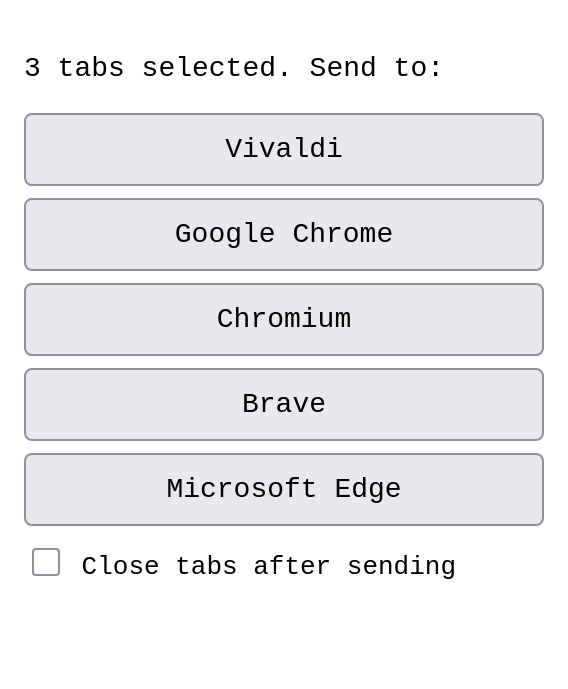
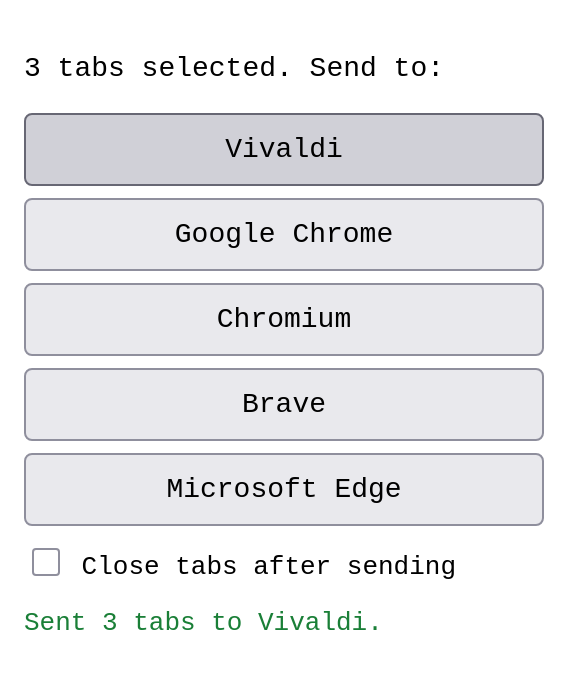
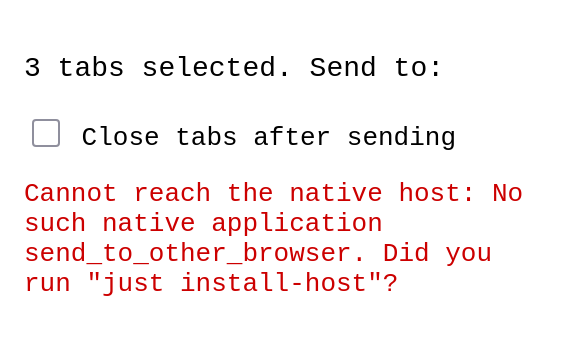

# Send to Other Browser

A Firefox, Zen Browser, LibreWolf, Chrome, Chromium, and Vivaldi extension that sends the URLs of
your selected tabs to another browser (Firefox, Zen Browser, LibreWolf, Vivaldi, Google Chrome,
Chromium, Brave, Edge) running on the same Linux machine.

Browser extensions cannot start other programs, so there are two parts:

1. **the extension** (`extension/` for Firefox, `extension-chromium/` for Chromium browsers): popup and tab context menu;
2. **a tiny native messaging host** (`host/`, Python 3, stdlib only) that starts the
   target browser with the URLs. A running target browser opens them as new tabs.

## Installation

The native host requires Linux and Python 3; it has no third-party Python dependencies.

1. Install the extension:
    * [Firefox extension from Mozilla Add-ons](https://addons.mozilla.org/en-US/firefox/addon/ff-send-to-other-browser/),
    * Chromium extension zip from the [GitHub releases](https://github.com/bergercookie/firefox-send-to-other-browser/releases).
2. Download the native-host archive from the
   [GitHub releases](https://github.com/bergercookie/firefox-send-to-other-browser/releases),
   extract it, and run the included installer. It registers the host for Firefox, Zen Browser,
   LibreWolf, Google Chrome, Chromium, and Vivaldi under their standard per-user Linux configuration
   paths.

> [!WARNING]
> The extension and native host currently support **Linux only**.
> Windows is not supported

## Supported browsers and installations

The installation format matters for the browser running the extension because that browser must be
able to start the native-messaging host.

| Sending browser | Native package (`.deb`/distro) | Tarball/manual install | Snap | Flatpak |
| --- | --- | --- | --- | --- |
| Firefox | Supported | Supported | Conditional; see [Snap Firefox](#snap-firefox) | Not supported |
| Zen Browser | Supported | Supported | Not supported | Not supported |
| LibreWolf | Supported | Supported | Not supported | Not supported |
| Chrome / Chromium | Supported | Supported when its executable is on the search path | Not supported | Not supported |
| Vivaldi | Supported | Supported when its executable is on the search path | Not supported | Not supported |

Firefox is the only supported Snap **sender**, using Ubuntu's patched native-messaging portal.
Sandboxed Flatpak browsers cannot discover or execute this native host, and other Snap browsers do
not provide the required portal integration.

Supported destination browsers are Firefox, Zen Browser, LibreWolf, Vivaldi, Google Chrome,
Chromium, Brave, and Microsoft Edge. Native packages and tarball/manual installations are supported
as destinations. The host can also launch known Flatpak exports and Snap launchers when they are
visible on the host system; that does not make those sandboxed builds supported as senders.

### Browser executable discovery

On Linux, discovery uses Python's `shutil.which`, which is equivalent to `which`: it searches
`SEND_TO_OTHER_BROWSER_PATH` first, then `PATH`, then common system, `/opt`, Snap, Flatpak export,
and per-user locations. When several installations of one browser exist, the first executable in
that search order is used. Set `SEND_TO_OTHER_BROWSER_PATH=/preferred/directory` to override it.

Firefox destinations include regular `firefox` and `firefox-esr` packages, `/opt` or per-user
tarball installs, the `/snap/bin/firefox` launcher, and the `org.mozilla.firefox` launcher exported
by Flatpak.

Zen Browser and LibreWolf are also supported as senders and destinations. Discovery recognizes
their regular executables, common `/opt` and per-user installations, and the Flatpak launchers
`app.zen_browser.zen` and `io.gitlab.librewolf-community`.

## Usage

Select tabs (ctrl/shift-click), click the toolbar button, and pick a browser. Alternatively,
right-click a tab and choose *Send to …*.

From Chrome, Chromium, or Vivaldi, Firefox appears as **Mozilla Firefox** when its executable is
installed. From Firefox, Firefox itself is hidden from the destination list; Chromium-family
browsers remain available.

If the target browser is already running, the URLs open as new tabs in its existing window
(the host never passes `--new-window`); a window is only created if the browser isn't running.

### Snap Firefox

A confined Firefox cannot spawn programs itself; on Ubuntu it asks `xdg-desktop-portal` to start the
host *outside* the sandbox. That needs a portal with Ubuntu's native-messaging patch (see
[the Ubuntu call for testing](https://discourse.ubuntu.com/t/call-for-testing-native-messaging-support-in-the-firefox-snap/29759))
and, if the host isn't found, `widget.use-xdg-desktop-portal.native-messaging` = `1` or `2` in `about:config`.
The manifest goes in the usual `~/.mozilla/native-messaging-hosts/` (the installer prints a reminder when it sees the snap).
Because the portal starts the host with a minimal environment, the host also searches standard
install locations (`/usr/bin`, `/snap/bin`, `/opt/vivaldi`, `/opt/google/chrome`, `~/.local/bin`, ...).

**Status: not verified end to end.** The development container has no systemd, so snapd cannot run there.
Verified: host discovery with an empty environment. Not verified: the portal hand-off with the real snap.
Please try it and report back; Flatpak Firefox is unsupported.
Release builds are unsigned: load them via `about:debugging`, or sign them through AMO.

## Screenshots

The Firefox popup with three tabs selected and every supported browser found, the confirmation after
sending them to Vivaldi, and the error shown when the native host is not registered:

| Popup | Sent | Host missing |
| --- | --- | --- |
|  |  |  |

They are generated from a real headless Firefox run by `just screenshots` and refreshed on
demand by the `screenshots.yml` workflow.

## Privacy

Nothing is collected or transmitted; see [PRIVACY.md](PRIVACY.md).

## Development

See the [development guide](DEVELOPMENT.md) for setup, tests, packaging, and automation.
